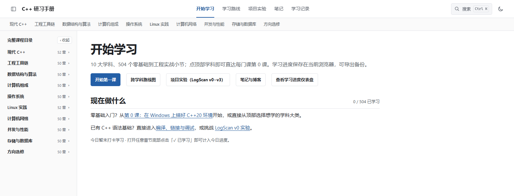
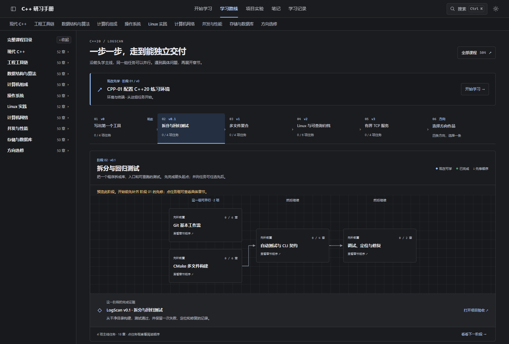
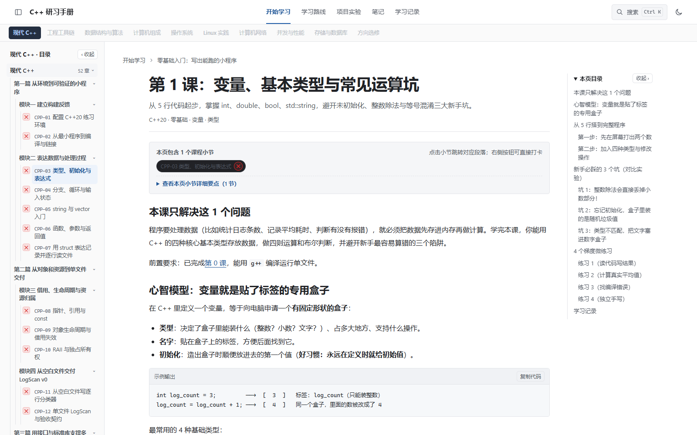
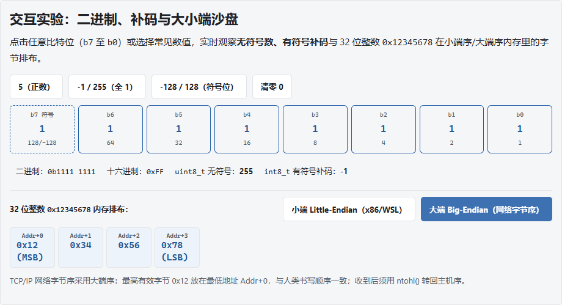

# Study Site · C++ 研习手册

一套以 **C++20** 为基线的中文学习站。从配置环境、写出第一个程序开始，逐步学习对象与资源、工程工具、算法、计算机系统、网络、并发和数据库，再用同一个 **LogScan** 项目把知识串起来。

**按学科查阅，按路线学习，用项目验收。**

[在线阅读](https://yjwyyds1.github.io/Study_Site/) · [从零开始](https://yjwyyds1.github.io/Study_Site/handbook/cpp-setup/) · [学习路线](https://yjwyyds1.github.io/Study_Site/roadmap/) · [课程总览](docs/course-outline.md) · [项目与验收](docs/curriculum/logscan.md)

## 网站预览

以下为站点实拍，截图中的章节数量以拍摄时的版本为准。拍摄时使用了全新的浏览器上下文。

### 学习首页与完整目录

从第一课开始，或直接进入某门学科。左侧目录按「学科 → 篇 → 模块 → 章节」展开，阅读页还提供页内目录。



### 分阶段箭头学习路线

六个阶段依次推进，每个阶段用任务卡和箭头说明先后关系。同组中互不依赖的任务可以并行；点击任务可展开具体章节、先修和阅读入口。



### 课程阅读与代码示例

在同一个页面查看讲解、代码、练习和相关章节。代码支持复制，配套源码可以下载，已学状态可按小节记录。



### 交互实验

通过操作观察变化，再回到正文解释原因。目前提供容器与借用、二进制与大小端、TCP 消息分帧等交互演示。



## 可以学到什么

课程目录包含 **10 门学科、552 个编号章节**。小节集中在专题讲义中，每个编号都可以从路线或目录打开对应的阅读位置。

| 学科 | 覆盖内容 | 完整目录 |
| --- | --- | --- |
| 现代 C++ | 环境与语法、指针与引用、对象生命周期、RAII、值语义、模板、Concepts、容器、Ranges、未定义行为 | [60 章](docs/curriculum/cpp.md) |
| 工程工具链 | 终端与路径、编译链接、Git、CMake、调试、测试、Sanitizer、CI、依赖与发布 | [50 章](docs/curriculum/engineering.md) |
| 数据结构与算法 | 复杂度、线性结构、哈希、树、堆、图、查找排序、搜索、动态规划、Top-K | [50 章](docs/curriculum/algorithms.md) |
| 计算机组成 | 编码、字节序、指令、调用栈、对齐、对象布局、缓存、汇编、ABI、SIMD | [58 章](docs/curriculum/machine.md) |
| 操作系统 | 系统调用、进程线程、调度、同步、虚拟内存、文件系统、IPC 与 I/O 模型 | [60 章](docs/curriculum/os.md) |
| Linux 实践 | Shell、权限、文件描述符、管道、信号、系统调用、mmap、epoll、strace、服务管理 | [58 章](docs/curriculum/linux.md) |
| 计算机网络 | 分层、IP、DNS、TCP/UDP、Socket、分帧、断连与超时、HTTP、TLS、抓包 | [58 章](docs/curriculum/network.md) |
| 并发与性能 | 线程、锁、条件变量、有界队列、退出、背压、原子操作、内存模型、测量与剖析 | [58 章](docs/curriculum/concurrency.md) |
| 存储与数据库 | 文件格式、SQL、SQLite、参数化查询、事务、索引、查询计划、WAL 与恢复 | [50 章](docs/curriculum/storage.md) |
| 方向选修 | Linux 服务端、基础设施与性能、Qt 桌面、嵌入式，以及作品交付与工程表达 | [50 章](docs/curriculum/tracks.md) |

共同主线面向 Linux 上的通用 C++ 工程开发，入门可先使用 Windows + MinGW，进入系统实践后再准备 Linux 或 WSL。涉及平台接口、实现差异和未定义行为时，应结合章节标注的环境与边界阅读。

目录设计、正文讲解、单项示例和完整实验的覆盖程度各不相同。课程仍在持续补充，实际运行验证范围见 [示例验证记录](docs/example-verification.md)，写作与验收设计见 [课程文档](docs/course-outline.md)。

## 从零怎么学

先打开 [环境搭建与乱码](https://yjwyyds1.github.io/Study_Site/handbook/cpp-setup/)，确认自己知道在哪里输入命令、当前工作目录是什么，以及怎样判断程序运行正确，再进入 [学习路线](https://yjwyyds1.github.io/Study_Site/roadmap/)。

路线把 **146 个主线章节组织成 27 个任务**，其余 **406 章按问题和方向补修**。先完成当前阶段需要的内容，再根据实际问题选择选练。项目实验页按 LogScan 的五个版本列出验收标准、参考材料和对应的先修阶段，也可以集中查看六项专题选练。[项目实验](https://yjwyyds1.github.io/Study_Site/labs/)

| 阶段 | 学习与实践 | 阶段产物及验收入口 |
| --- | --- | --- |
| 01 · v0 | 环境、最小程序、语法、逐行读取、生命周期与资源 | [单文件日志统计工具](src/content/labs/logscan.md)，检查正常、空输入、坏行和文件打开失败 |
| 02 · v0.1 | Git 与 CMake 可并行学习，再完成拆分、调试与回归测试 | [解析库 + 命令行入口 + CTest](src/content/labs/logscan-build.md) |
| 03 · v1 | 值类型、容器选型、错误边界、确定的输出顺序 | [多文件聚合与报告](src/content/labs/logscan-v1.md) |
| 04 · v2 | Linux 进程与文件观察、SQLite 导入、查询、事务与索引 | [可查询日志归档](src/content/labs/logscan-v2.md) |
| 05 · v3 | 分别补齐网络与并发，再汇合到队列、持久化与退出 | [有界 TCP 收集服务](src/content/labs/logscan-service.md) |
| 06 · 方向作品 | 根据基础与兴趣选择服务端、性能、桌面或嵌入式 | [作品范围、依赖与可复现证据](docs/curriculum/tracks.md) |

实验页包含输入、操作、预期结果和失败路径。先看现象，尝试解释，再修改代码或输入，最后用输出、调试器或测试核对结果。已有基础的读者可以通过阶段实验检查是否需要补修。

详细顺序见 [默认路线与补修入口](docs/curriculum/route.md)，知识与练习的对应关系见 [覆盖矩阵](docs/curriculum/coverage.md)。

## 阅读与学习记录

- **快速定位**：完整章节树、学科入口、页内目录与 `Ctrl K` 全站搜索。
- **章节直达**：路线任务和全部课程索引均可跳转到对应讲义的小节。
- **按小节记进度**：标记已学或未学，查看总进度、每日热力图、近 14 天趋势与各学科完成度。
- **学习档案与复盘**：记录每周任务、方向与调整依据，导出学习复盘 Markdown。
- **私人笔记**：导入自己的 Markdown，添加标签和课程关联，保留原文，支持预览。
- **备份迁移**：导出完整 JSON，导入前预览，确认替换时保留上一份快照。
- **阅读偏好**：浅色与深色主题，左右目录可收起，小屏下折叠导航。

### 在线版与本地版

| 项目 | GitHub Pages 在线版 | 本地运行 |
| --- | --- | --- |
| 课程、路线、搜索、交互实验 | 支持 | 支持 |
| 进度、档案与私人笔记 | 当前浏览器的 localStorage | localStorage + 本机 SQLite 同步 |
| 学习仪表盘、JSON 导入导出 | 支持 | 支持 |
| SQLite API 服务 | 无 | 由 Node.js 本地服务提供 |
| 跨设备迁移 | 手动导出、导入 JSON | 手动导出、导入 JSON |

在线版的学习数据保存在访问者自己的浏览器中，不会同步到 GitHub。清除网站数据、更换浏览器或设备前，请在「学习记录 → 备份导出与恢复」导出 JSON。不同域名或端口使用不同的浏览器存储空间，在线版与本地版也需通过备份迁移。

本地数据库默认位于 `data/study-progress.db`。`data/`、`private/`、备份和复盘导出均在 Git 忽略规则中。关闭本地服务后，已有浏览器数据仍会保留。私人笔记最多 40 篇，每篇最多 24,000 字符，整份状态数据上限 1.5 MB；原始 Markdown 请另行保存。项目当前没有 AI API 请求或账户登录功能。

## 本地运行

需要 **Node.js 24 或更新版本**。阅读网站本身不需要 C++ 编译器；运行课程示例时再准备支持 C++20 的工具链。

```bash
git clone https://github.com/yjwyyds1/Study_Site.git
cd Study_Site
npm ci
npm run dev
```

打开 [http://127.0.0.1:4321](http://127.0.0.1:4321/)，终端保持运行，按 `Ctrl+C` 停止。Windows PowerShell 如果限制运行 `npm.ps1`，把命令中的 `npm` 换成 `npm.cmd`。

开发服务会自动刷新课程修改。需要查看生产构建时：

```bash
npm run build
npm run preview
```

预览默认也使用 4321 端口，需先停止开发服务；`npm start` 与 `npm run preview` 一样提供静态文件和本地 SQLite API。更换端口会使用另一套浏览器存储，迁移前先备份。

Windows 入门可使用 CLion + MinGW；Linux 系统课需要 Linux 或 WSL，以及编译器、CMake、Git、GDB 等工具。各实验的额外依赖以实验页说明为准。

## 检查与测试

```bash
npm test
npm run build
npm run test:browser
```

单元测试覆盖状态校验、备份、学习进度、SQLite 持久化与在线版浏览器存储。浏览器测试覆盖导航、章节跳转、学习记录、交互实验和箭头路线，默认使用已安装的 Microsoft Edge；使用 Chrome 时可设置 `STUDY_BROWSER=chrome`。

LogScan v0 另有 PowerShell 验收脚本，需要 `g++`：

```powershell
powershell.exe -NoProfile -File .\tests\logscan.ps1
```

其他里程碑的命令、正常与失败用例见对应实验页。网站测试通过代表站点功能得到验证，课程 C++ 示例的验证范围单独记录在 [示例验证文档](docs/example-verification.md)。

## 发布到 GitHub Pages

仓库使用 [GitHub Actions](.github/workflows/deploy-pages.yml) 构建在线版。推送到 `main` 后，依次安装依赖、运行单元测试、生成静态页面并部署到 Pages，也可在 Actions 中手动触发。

- 访问地址：<https://yjwyyds1.github.io/Study_Site/>
- GitHub 设置：`Settings → Pages → Source → GitHub Actions`。
- 项目路径：工作流按仓库名设置 `STUDY_BASE_PATH`，本站为 `/Study_Site`。
- 在线存储：`PUBLIC_STUDY_STATIC=true`，仅使用浏览器存储，不请求本地 SQLite API。
- 发布内容：仅上传 `dist/` 静态产物，个人学习数据库和笔记不随站点发布。

首次部署及后续构建结果可在 [Actions](https://github.com/yjwyyds1/Study_Site/actions) 查看。仓库 About 中的网站地址指向 Pages。

## 目录结构与内容维护

```text
.github/workflows/       GitHub Pages 自动构建与发布
docs/curriculum/        十门学科目录、路线、覆盖矩阵与验收设计
docs/screenshots/       README 页面截图
public/examples/       C++ 示例、实验参考工程与输入
src/content/handbook/   课程正文 Markdown
src/content/labs/       LogScan 实验与验收指导
src/content/notes/      公开的学习方法与笔记示例
src/data/               站点课程配置
src/lib/                目录映射、学习路线、状态与本地 API
src/pages/              首页、阅读页、路线和学习记录
src/components/         导航、交互实验与阅读组件
scripts/                开发启动与本地预览服务
tests/                  状态、浏览器与 LogScan 验证
```

增加或调整课程时，先维护 `docs/curriculum/` 中的稳定编号、先修、阅读映射和验收设计，再更新对应 Markdown 正文。完整学科目录由 `src/lib/full-curriculum.mjs` 读取，路线由 `src/lib/learning-graph.mjs` 组织；`src/data/curriculum.mjs` 保留站点课程与文章配置。

正文使用小写英文文件名，必填 `title`、`description`，可添加 `tags`、`related` 与 `sources`。正文独立一行写 `{{example:hello.cpp}}`，可在构建时嵌入 `public/examples/hello.cpp`，让讲解与下载使用同一份源码。新增章节后检查目录映射、锚点跳转、搜索和进度记录；已有编号与文章路径应保持稳定。

相关文档：[课程总览](docs/course-outline.md) · [学习方法](docs/course-method.md) · [实验与验收](docs/curriculum/logscan.md) · [覆盖矩阵](docs/curriculum/coverage.md) · [示例验证](docs/example-verification.md) · [架构说明](docs/architecture.md)
